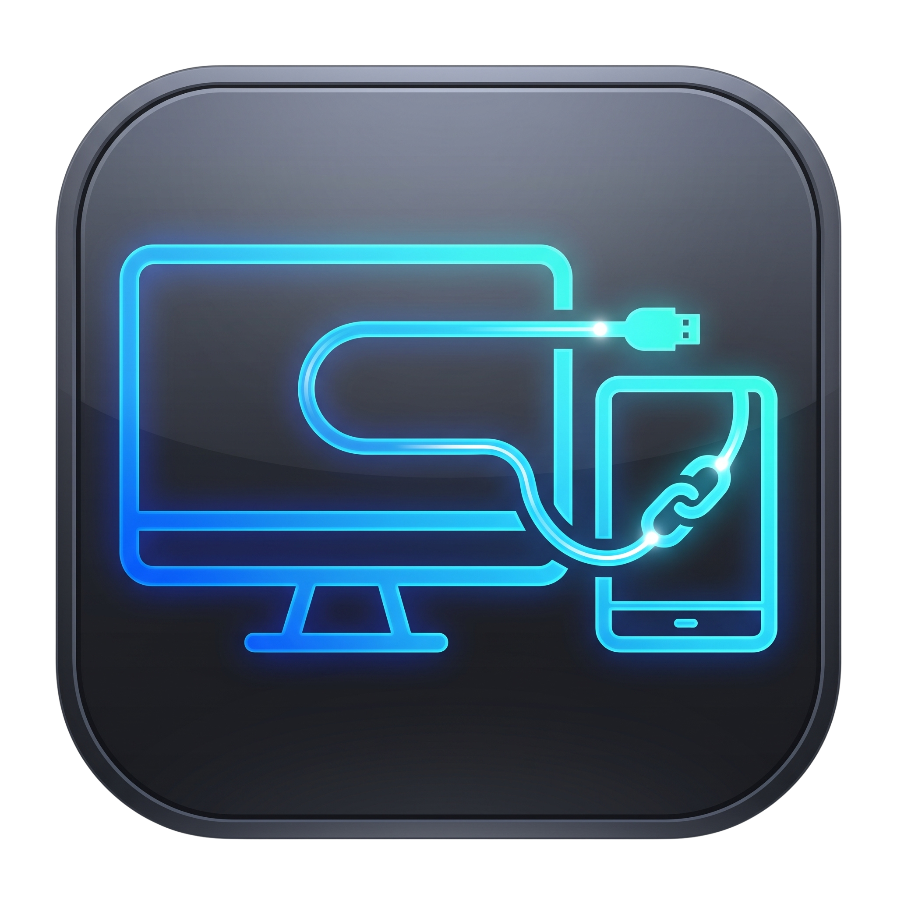
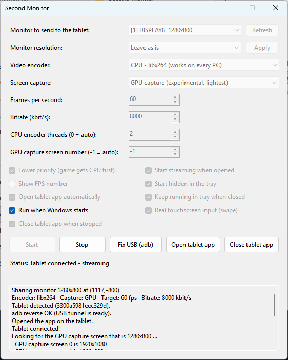
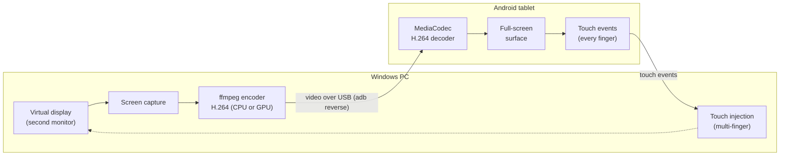

<p align="center"></p>
<h1 align="center">Second Monitor</h1>

<p align="center">
  <b>Turn your Android tablet into a real extended monitor and touchscreen for your Windows PC, over a USB cable, with low latency.</b>
</p>

<p align="center">
  
  
  
  
</p>

<p align="center">
  Windows &middot; Android tablets &middot; C# + Java &middot; H.264 over USB
</p>

<p align="center">
  <a href="../../releases">Download</a> &middot;
  <a href="#install">Install</a> &middot;
  <a href="#use">Use</a> &middot;
  <a href="#how-it-works">How it works</a> &middot;
  <a href="#options">Options</a> &middot;
  <a href="#build-from-source">Build</a> &middot;
  <a href="#troubleshooting">Troubleshooting</a>
</p>

---

Use an Android tablet as a real **extended display** for a Windows PC over a **USB cable**.
The PC streams H.264 video to the tablet, and the tablet works as a real **touchscreen** (swipe to scroll, pinch, multi-finger).
No account, no subscription, no expiry.

<p align="center"></p>

## How it works



The PC streams the virtual monitor as H.264 video over the USB cable, and the tablet draws it with its
hardware decoder. Your finger touches travel back over the same cable and Windows treats them as a real
touchscreen.

## Features

- Wired, low-delay streaming (about 110-170 ms at 1280x800, 60 fps in testing)
- Works on old tablets: the tablet app supports **Android 5.0+** and uses the hardware decoder
- Real touchscreen input: Windows sees genuine touches, so swiping scrolls lists and pinching zooms.
  Can be switched to plain mouse mode (single finger = left click and drag)
- Open and close the tablet app from the PC, by a button or automatically
- A settings window: pick the monitor, resolution, encoder and frame rate. No command line
- Encoder choices: **CPU (libx264)**, AMD (AMF), Intel (QSV), NVIDIA (NVENC)
- Screen capture choices: **Standard** or **GPU capture** (ffmpeg `ddagrab`, experimental)
- Optional automation: start with Windows, start streaming by itself, live in the system tray,
  and open the app on the tablet automatically when it is plugged in

## Tested on

Only one setup so far: a **Samsung Galaxy Tab S 10.5 LTE (Android 5.0.2)**, a Windows PC running
**AMD RX 570**, **Ryzen 5 5600**, and the Virtual Display Driver.

| Part | Status |
|---|---|
| CPU encoder (libx264) + Standard capture | Tested, the recommended setup |
| GPU capture with the CPU encoder | Worked in testing, similar speed to Standard capture |
| AMD hardware encoder | Works, but had a noticeably higher delay than the CPU encoder |
| Intel and NVIDIA encoders | Untested |
| Automatic start / tray / auto-open tablet app | Newer, lightly tested |
| Real touchscreen input (swipe to scroll) | Works in testing. Untick it to fall back to mouse mode |

Reports and fixes for other hardware are very welcome.

## What you need

On the PC:
- **Windows 10 or 11, 64-bit**
- **.NET 10 Desktop Runtime** (the .NET 10 SDK includes it) - [link](https://dotnet.microsoft.com/en-us/download/dotnet/10.0)
- **ffmpeg**, a recent [build](https://github.com/ffmpeg/ffmpeg) (6.0 or newer for GPU capture).
  Put `ffmpeg exe` next to `SecondMonitor.exe` or in your PATH
- **adb** (Android platform-tools) in your PATH -
[link](https://developer.android.com/tools/releases/platform-tools)
- A **virtual display driver** that adds a second monitor, for example
  [Virtual Display Driver](https://github.com/VirtualDrivers/Virtual-Display-Driver).

  **`winget install --id=VirtualDrivers.Virtual-Display-Driver -e`**

On the tablet:
- **USB debugging** turned on (Settings > About > tap Build number 7 times, then Developer options)
- Permission to install the APK (allow installs from unknown sources)

## Install

1. Download `SecondMonitor.apk` and `SecondMonitor.exe` from the [Releases](../../releases) page.
2. Install the APK on the tablet.
3. Plug the tablet into the PC with a USB cable and tap **Allow** on the "Allow USB debugging?"
   prompt (tick "Always allow"). `adb devices` should list it as `device`.

## Use

1. Open `SecondMonitor.exe`.
2. Pick the virtual monitor (not your main screen), an encoder and your other options.
3. Press **Start**. While it runs, the program watches for the tablet. When the tablet is plugged in,
   it sets up the USB tunnel (`adb reverse`) and opens the app on the tablet by itself.
4. Drag windows onto the extended display.

Your choices are saved in `%APPDATA%\SecondMonitor\settings.txt`.
Settings from older versions beside the executable are still read when migrating.
If something goes wrong with the cable, press **Fix USB (adb)**. **Open tablet app** and
**Close tablet app** open and close the app on the tablet by hand.

Press **Check setup** before streaming to check ffmpeg, the selected encoder, adb authorization,
the selected monitor, and whether the tablet app is installed. Results appear in the log.
If USB setup fails, the program retries automatically with a short, increasing delay;
you do not need to unplug the tablet just to retry.

If the selected monitor is moved or resized while streaming, the program reconnects using
its new dimensions. If that monitor disappears, it waits for it to return.

### Automatic start

Tick these and everything runs by itself:
1. **Run when Windows starts**: the program starts when you log in to Windows.
2. **Start streaming when opened**: it starts streaming immediately, no need to press Start.
3. **Start hidden in the tray**: no window; it lives in the system tray by the clock
   (double-click the icon to open the window, right-click for Exit).
4. **Open tablet app automatically**: when the tablet is plugged in, the app opens on it.

Then you only plug the tablet in. This needs USB debugging allowed for the PC ("Always allow"),
and the virtual monitor must already exist when you log in (it is a driver, so it normally does).
If the tablet's screen is locked, the app opens behind the lock screen; unlock the tablet to see it.

## Options

| Option | What it does |
|---|---|
| Monitor | The virtual monitor to send to the tablet (not your main screen). Press Refresh after changing monitors. |
| Monitor resolution | Changes the virtual monitor's resolution (Apply, or automatically on Start). It lists only modes the virtual display driver offers, up to 60 Hz. Never changes your main screen. |
| Video encoder | **CPU (libx264)** works everywhere and had the lowest delay. **AMD / Intel / NVIDIA** use the graphics card, which takes load off the CPU but may add delay. |
| Screen capture | **Standard** takes screenshots in the program (most compatible). **GPU capture** lets ffmpeg grab the screen with the graphics card. |
| Frames per second | 60 is smoothest. 30 uses about half the work. |
| Bitrate | Video quality budget. 8000 kbit/s is plenty for 1280x800. |
| CPU encoder threads | Limits how many CPU threads libx264 may use, so a game keeps the rest. 0 = no limit. |
| GPU capture screen number | Which screen ffmpeg's GPU capture uses. -1 = find it automatically by matching the monitor's size. |
| Lower priority | Windows gives a game the CPU first. The tablet video may stutter a little instead. |
| Show FPS number | Shows frames per second in the window. Off is smoothest. |
| Open tablet app automatically | When the tablet is plugged in, opens the app on it using adb. If you rename the Android package, change `TabletAppComponent` in `StreamEngine.cs`. |
| Close tablet app when stopped | Closes the app on the tablet when you press Stop or exit the program. |
| Real touchscreen input | Sends genuine touch input to Windows (swipe to scroll, pinch to zoom). Unticked, one finger acts as the mouse. If Windows refuses touch input, the program falls back to mouse mode by itself. |
| Run when Windows starts | Adds the program to your Windows startup list (your user account only). |
| Start streaming when opened | Starts streaming as soon as the program opens. |
| Start hidden in the tray | Opens without a window, as an icon in the system tray. |
| Keep running in tray when closed | The X button hides the window instead of exiting. Use Exit in the tray menu to really quit. |

## Build from source

**PC program** (needs the .NET 10 SDK):

```
build-exe.bat           builds the app folder; needs no downloads
build-single-file.bat   builds ONE exe; needs an internet connection for NuGet
```

`build-exe.bat` creates `app\SecondMonitor.exe` plus a few small files next to it (keep them
together, for example in a zip). `build-single-file.bat` creates one `app-single\SecondMonitor.exe`.
Neither contains .NET, so they are small but need the .NET 10 Desktop Runtime on the PC.

**Tablet app:** open the Android project in Android Studio (Java, minSdk 21, package
`com.example.secondmonitor`) and use **Build > Generate App Bundles or APKs > Build APK(s)**.

## Known limitations

Development checks and a Windows/tablet validation checklist are documented in
[docs/validation.md](docs/validation.md).

- Programs that don't support touch only react to taps, not swipes. Windows that run as administrator ignore touch unless `SecondMonitor.exe` also runs as administrator.
- The tablet app and `SecondMonitor.exe` must be updated together: a new app with an old exe sends no usable touch.
- Standard capture draws the cursor as a plain arrow. GPU capture draws the real cursor.
- Windows only. The tablet needs a cable (USB debugging); there is no wireless mode.

## Troubleshooting

- **`Could not start ffmpeg`**: ffmpeg isn't installed or isn't found. Put `ffmpeg.exe` next to `SecondMonitor.exe` or in PATH.
- **`Could not run adb`**: Android platform-tools isn't in your PATH.
- **`Could not open port 7777`**: another copy of the program is still running.
- **The tablet app doesn't open by itself**: check the log. The tablet must allow USB debugging for this PC, and the app must be installed.
- **Black tablet screen + `[ffmpeg]` errors in the log**: read the error. For a graphics-card encoder, try CPU (libx264). For GPU capture, try Standard.
- **The resolution you want isn't in the list**: the virtual display driver doesn't offer it. Add it to the driver's settings file (`vdd_settings.xml` for Virtual Display Driver) and reload the driver (disable and enable the adapter in Device Manager).
- **Touch lands in the wrong spot**: make sure you chose the virtual monitor.

## Credits

Video encoding by [FFmpeg](https://ffmpeg.org/). The virtual monitor comes from a third-party virtual
display driver. Neither is included in this project.
